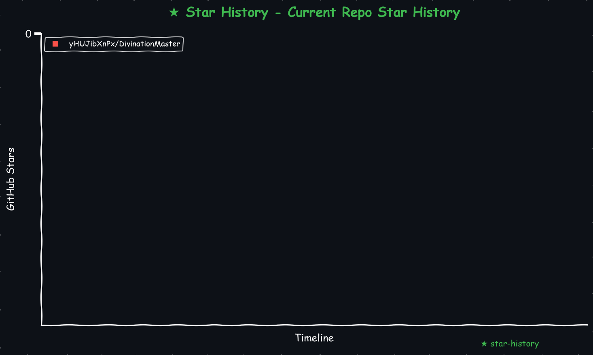
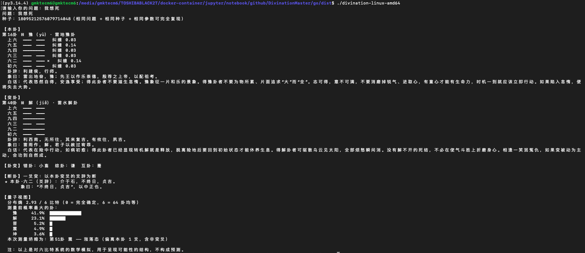

# 占卜周易脚本 
开发的占卜算卦脚本，用来测吉凶  

    

<!-- START_STAR_HISTORY_SELF -->

<!-- END_STAR_HISTORY_SELF -->

## 描述
几年过去了我依旧过得不好，找不到工作，事事不顺心，我好痛苦，所以开发了占卜算卦脚本，用来探测命运，唉😔

周易占卜 + 六比特态向量引擎。Go 编写，仅用标准库，编译成**单个静态二进制**（语料已内嵌，不需要任何运行时或数据文件）。

```bash
./divination "我该接受这份工作吗？"            # 起卦并解读（等价于 ask）
./divination ask "问题" --seed 42 --json       # 可复现、机器可读
./divination show 屯                           # 一整卦：卦辞 + 六爻爻辞 + 象传（卦名/序号/卦码均可）
./divination history -n 10                     # 最近的记录（history.jsonl）
```

## 安装

* **预编译**：`dist/` 里有 `divination-linux-arm64`（Termux / Android arm64）、`divination-darwin-arm64`（Apple Silicon）、`linux-amd64`、`darwin-amd64`，附 `SHA256SUMS`。都是静态编译（无 cgo），不依赖系统库，**在任何 Linux 内核上都能运行，但 CPU 架构必须一致**（手机/树莓派用 arm64，普通 PC 用 amd64；`darwin-*` 只能在 macOS 上用）。
* **自己编译**（需要 Go ≥ 1.24，因为用到标准库 `crypto/sha3`）：`./build.sh` 交叉编译四个平台到 `dist/`；或 `go build ./cmd/divination`。
* **测试**：`go test ./...`

## 它做了什么

1. **起卦**：三枚铜钱，每爻得 6/7/8/9（概率 1:3:3:1），即老阴/少阳/少阴/老阳；老阴老阳是变爻，得到本卦与变卦。
2. **断卦**：按朱熹《易学启蒙》的通行读法，由变爻数量决定读本卦还是变卦、读卦辞还是爻辞（0 变读本卦卦辞，1 变读变爻爻辞，……，乾坤六爻皆变读「用九/用六」）。读到的爻辞若已有白话，会紧跟在原文后显示。
3. **量子视图**：把六爻建模为六个量子比特（64 卦 = 64 个基态），展示"本卦 → 变卦"之间的可能性分布，再按玻恩规则测量坍缩出一个具体的卦。

### 量子引擎（`internal/quantum`）

* **制备**：不变的爻（少阳/少阴）处于确定态；变爻处于"本态 ↔ 变态"各 50% 的叠加，翻转分量的相位由 `SHAKE256(种子|问题)` 决定。
* **纠缠**：应位（初–四、二–五、三–上）上的受控相位门。只有应位两爻**同为变爻**时才真正产生纠缠（约 17% 的占卜），此时才会显示"应位纠缠"。
* **干涉**：对处于叠加态的比特做 Rx，把相位转成概率差异。
* **测量**：按玻恩规则抽样。

默认配置下**不变的爻绝对稳定**，测量结果恒落在"本卦 → 变卦"的路径上，与传统断卦不矛盾；无变爻的静卦，结果完全确定。

参数：`--fuzz`（稳定爻的涨落角，默认 0；设为 0.2 则所有爻都带涨落，结果可能偏离路径）、`--entangle`（应位纠缠角，0 = 不纠缠）、`--interfere`（干涉角，0 = 不干涉）。三者都为 0 时，可能的卦恰是"变爻任意子集翻转"的 2^k 个、且等概率（有测试）。

> **取舍**：旧默认值 `fuzz=0.2` 下，约 27% 的占卜会测得一个既不是本卦、也不是变卦、也不在两者路径上的卦，与传统读法冲突；现默认值下为 0%，代价是结果分布更集中（分布熵中位数 2.87 → 1.00 比特）。想要更"发散"的探索，用 `--fuzz 0.2`。

几点必须说清楚：

* **错卦、综卦是酉变换**（置换算子），可作用于态向量；**互卦不是**（64→16 多对一，不可逆），只能作用于测量结果。
* 问题的措辞**只**通过相位影响干涉图样，没有任何语义。
* 这是对六比特系统的数学模拟，**不增加任何预测能力**；价值在于呈现可能性的结构，而不是给出吉凶判决。
* 随机性来自确定性伪随机数（xoshiro256**，种子取自操作系统熵），不是物理上的量子随机。
* 同一 `(问题, 种子, 引擎参数)` 总是得到同一个结果；每次占卜都会打印种子，便于复现。

## 目录

```
cmd/divination/        入口
internal/
  hexagram/            卦码、四态爻、错/综/互、置换算子（纯函数）
  quantum/             六比特态向量引擎（制备/纠缠/干涉/测量）
  rng/                 SplitMix64 播种 + xoshiro256**（跨平台位级一致）
  reading/             三枚铜钱起卦 + 变爻读法
  corpus/              语料加载；iching.json（经传原文）与 vernacular.json（整卦白话 + 爻辞白话）均 go:embed
  core/                一次占卜的编排，Result 即 history.jsonl 的记录格式
  render/              终端排版
  history/             追加写入的 JSON Lines 历史
  cli/                 命令行
  golden/              冻结的回归快照测试
testdata/              golden.json、history_sample.jsonl
build.sh               交叉编译
```

卦码约定：6 位 0/1 字符串，**自初爻到上爻**（自下而上），1 = 阳。

## 修订爻辞白话的流程

白话放在 `internal/corpus/vernacular.json`，按卦码一卦一条：`summary` 是整卦概说，`judgement` 是卦辞白话，`lines` 是六爻白话，乾坤另有 `extra` 对应用九/用六（六爻自初爻到上爻，乾坤另有 `extra` 对应用九/用六）。每批只新增几条记录，不碰主语料。加载时会严格校验——卦码存在、六爻齐全、每条以「。」或「）」收尾、`extra` 只能给乾坤——格式不对会直接拒绝启动，不会悄悄漏掉。卦辞白话另有一张独立手写的关键词表（防止错贴到别的卦；不能用字符重合度，因为很多卦辞是「元亨利贞」之类的程式化用语），并要求带转写的条目与披露清单完全一致。整卦概说另有风格测试：长度、必须提到自己的卦名（防止张冠李戴）、不得重复、不得出现断言式或贬损性措辞。

```bash
# 1. 修改或新增 vernacular.json 里的条目（转写处按体例加“（原文……”说明，并把它登记进 corpus_test.go 的 mustDisclose）
go test ./...                          # 校验格式；corpus 测试会打印进度
go test ./internal/golden -update      # 白话会出现在 show/断卦的输出里，快照需要更新
git diff testdata/golden.json          # 审阅：差异应当只有新增的白话行
```

## 回归快照（`internal/golden`）

`testdata/golden.json` 固定了 RNG 序列、54 组引擎概率分布、读法、36 组整次占卜和 17 组 CLI 整段输出。最初的向量由已移除的 Python 参考实现生成，并验证与 Go 实现一致（RNG 位级一致、概率分布 1e-12 内、读法与终端输出逐字一致）。

有意改动引擎或渲染后：

```bash
go test ./internal/golden -update    # 重新生成
git diff testdata/golden.json        # 必须逐项审阅变化
```

重新生成之后，快照就是 Go 自己产出的，不再是独立的参照物——**不要盲目更新**。

## 数据来源与限制

* 卦辞、爻辞、象传：《周易》经传原文（古籍），整理自 [john-walks-slow/open-iching](https://github.com/john-walks-slow/open-iching)。该仓库未附许可证，自述"采集自互联网，仅供学习交流，不得用于商业用途"；再分发前请自行留意。
* **整卦概说**（每卦一段，显示在卦象下方的「概说：」）：本项目新写，由 Claude 依据卦辞、大象传与爻辞概括，每卦 2–3 句，讲清**核心意象、处世启示与要留意的另一面**；描述态度与处境，不下吉凶判决，不替人做决定，也不用性别或身份作论据。旧版 `hexagram.json` 里的整卦白话（抓取自网络、来源无法核实的文本）已**不再随项目分发**，`iching.json` 现在只含经传原文。
* **爻辞白话**：本项目新写（不引自任何现代译本），**已覆盖全部 64 卦、386 条**（384 爻 + 乾「用九」+ 坤「用六」）；另有**全部 64 条卦辞的白话**，显示在 `show` 的卦辞下方，占卜时读到卦辞也会一并显示。由 Claude 撰写，未经第三方审校。爻辞本义历来有多种解读，这里取较通行的一种，分歧大的地方在括号里注明，仅供参考。
* **转写体例**：原文与象传一字不动，只在白话里转写。遇到带有时代烙印的内容（古代的性别观念、封建制度、战争比喻等），白话取其不变的道理，并用「（原文……；这里取其……）」明确标出与字面古义的出入，让读者分得清翻译与转写。这条体例有测试强制检查：全部 386 条白话里有 107 条属于转写，每一条都带「（原文……」说明，漏标会被测试拦下。
* **原文校勘**：源数据有笔误，已据通行本更正：坎卦卦辞补回开头的「习坎」；乾九二（爻辞与象传）「再田」→「在田」；象传四处：讼初六「有小言」→「小有言」、师六五「弟子舆师」→「弟子舆尸」、晋初六「晋中摧如」→「晋如摧如」、咸九五「志未也」→「志末也」。目前的校勘手段有三：每批翻译前逐字核对；「象传所引爻辞必须是爻辞原文的子串」的自动检查（常驻测试）；对生僻字、易混形近字的人工筛查。局限：这些都抓不到「爻辞与象传同时写错成同一个常见字」的错误，源数据又没有第二来源可供整体对照，所以其余原文**没有被系统校勘过**。
* `history.jsonl` 含问题原文，已加入 `.gitignore`。

## 尚未验证

* 非 amd64 的二进制只做了交叉编译，开发环境里没有实际运行过（开发环境是 linux-amd64）；静态编译的 Go 程序通常没有问题，但这一点没有亲自验证。
* 浮点结果在不同架构上可能有末位差异（sin/cos 实现、是否融合乘加）。"同种子同卦"在数学上成立，但某个浮点边界上理论上可能偶发分歧（量级约 1e-12/次）。

## 效果图


# 声明
本项目仅作学习交流使用，用于查找资料，学习知识，不做任何违法行为。所有资源均来自互联网，仅供大家交流学习使用，出现违法问题概不负责。
